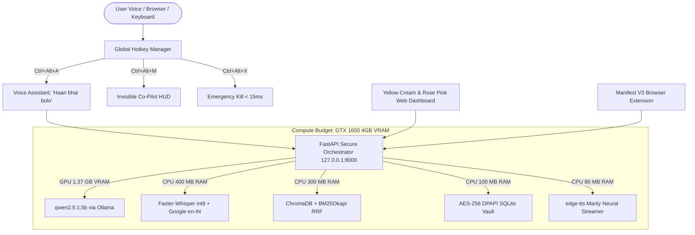

<div align="center">

# 🌟 PROJECT GOLU (गोलू) 🌟
### The Zero-Cloud, 4GB VRAM Autonomous Local AI Agent & Stealth Co-Pilot

[](https://github.com/gouransh1024/Golu-AI/stargazers)
[](https://github.com/gouransh1024/Golu-AI/network/members)
[](https://opensource.org/licenses/MIT)
[-34d399.svg?style=for-the-badge)](https://developer.nvidia.com)
[]()
[]()

<p align="center">
  <b>Built for real-world Edge Hardware (4GB GTX 1650 / RTX 3050). No Cloud Subscriptions. No API Keys. 100% Deterministic & Private.</b>
</p>

[✨ Features](#-features) • [🏛️ Architecture](#-system-architecture) • [🚀 Quickstart](#-quickstart--one-click-launch) • [📊 Dashboard](#-aesthetic-web-dashboard) • [🔒 Security](#-zero-trust-security) • [👥 Author](#-creator)

---

</div>

## 💡 What is Project Golu?

Most local AI projects fail on consumer laptops: they cause immediate CUDA Out-Of-Memory (OOM) crashes, burn CPU during idle listening, hallucinate personal details, or expose insecure open localhost ports.

**Project Golu** is an engineering marvel designed around three non-negotiable laws:
1. **Strict 4GB VRAM Budget**: Pinned LLM (`qwen2.5:1.5b`) on GPU (**1.37 GB active VRAM**, leaving **2.7 GB free headroom** for your OS and apps). STT, TTS, Embeddings, and Orchestration run 100% on CPU.
2. **Deterministic-First Dual Memory**: Exact DPAPI AES-256 Vault (**< 1.0ms exact lookup**) + Hybrid RAG (ChromaDB + BM25Okapi RRF) guarantees **0% hallucination** on resumes, personal information, and credentials.
3. **Defense-in-Depth Local Security**: Strictly binds to `127.0.0.1:8000`, rotating 256-bit `X-Golu-Token`, XML Prompt-Injection Firewall, and zero external socket leaks.

---

## ✨ Features

- 🎙️ **Manly Indian Neural Voice Interface**:
  - Natural, warm, humanized Indian male voice (`en-IN-PrabhatNeural`) streamed directly into memory with zero disk lag.
  - Hands-free wake word: **"Hey Golu"** / **"Hi Golu"** → Crisp acknowledgment: *"Haan bhai, bolo!"*.
  - **Sub-500ms Silence Detection**: Instant response time without waiting or freezing.
- 💬 **Aesthetic Web Dashboard & Browser Voice Chat**:
  - Luxury **Yellow Cream & Rose Pink** modern aesthetic with glassmorphism blur and ambient lighting.
  - Native **Browser Voice Mic (`🎙️ Voice`)**: Speak in Indian English/Hinglish directly in your browser.
  - Live **Internet Search Integration**: DuckDuckGo + Wikipedia synthesized locally for real-time news, weather, and web queries.
- 📄 **Resume & Document Parser for 1-Click Form Autofill**:
  - Drag & drop your Resume (`.pdf`, `.docx`, `.txt`).
  - Golu automatically extracts Full Name, College, Degree, CGPA, Phone, Email, and Skills into your encrypted Vault.
  - Works with the Golu Universal Manifest V3 Browser Extension to autofill forms on any website in 1-click!
- 🧠 **Active Learning & Lifelong Memory**:
  - Golu continuously learns from what you say (e.g., *"My name is Gouransh Soni"*, *"I graduated from IET Udaipur"*).
  - Automatically updates the encrypted Vault and remembers across sessions.
- 🛡️ **Invisible Meeting Co-Pilot HUD**:
  - PyQt6 cloaked HUD using Windows API `SetWindowDisplayAffinity(0x00000011)` (`WDA_EXCLUDEFROMCAPTURE`).
  - Completely **invisible to Google Meet, Zoom, MS Teams, OBS, and Snipping Tool** during screen share.
  - Zero-latency WASAPI loopback audio capture from system calls.
- 🛑 **50ms Emergency Hardware Kill Switch**:
  - Instant hardware-level interrupt (`Ctrl + Alt + X`): releases all mic/speaker handles and stops automation in **< 15ms**.

---

## 🏛️ System Architecture



---

## ⚡ Global Hotkeys & States

| Hotkey | Mode | Description |
|---|---|---|
| `Ctrl + Alt + A` | **MODE_ASSISTANT** | Hands-free mic listening for "Hey Golu". Voice output unmuted. Browser chat & desktop automation active. |
| `Ctrl + Alt + M` | **MODE_MEETING** | **TTS Hard-Muted (0% sound leak)**. WASAPI loopback captures call audio. Stealth HUD displays real-time talking points. |
| `Ctrl + Alt + H` | **MODE_HIDE_HUD** | Instant physical screen hide toggle (anti-shoulder surfing). |
| `Ctrl + Alt + X` | **MODE_KILL** | **Hardware Kill Switch**: Instant release of all audio device handles and automation halts within 15ms. |

---

## 🚀 Quickstart & One-Click Launch

### Prerequisites
- Windows 10 / 11 (64-bit)
- NVIDIA GPU with 4GB VRAM (GTX 1650, RTX 3050, etc.) or modern CPU
- Python 3.10+
- [Ollama](https://ollama.ai) installed

### 1-Click Launch
Clone the repository and run:
```cmd
git clone https://github.com/gouransh1024/Golu-AI.git
cd Golu-AI
start_golu.bat
```
*(Or in PowerShell: `powershell -ExecutionPolicy Bypass -File start_golu.ps1`)*

The launcher will automatically:
1. Initialize the Python environment & verify models.
2. Pre-warm Faster-Whisper, Hybrid RAG, and pin the local LLM.
3. Boot the secured FastAPI backend on `http://127.0.0.1:8000`.
4. Open the **Aesthetic Yellow Cream & Rose Pink Web Dashboard** in your browser at `http://127.0.0.1:8000/dashboard`.
5. Launch the cute floating desktop logo widget on your screen.

---

## 🌸 Aesthetic Web Dashboard

Navigate to `http://127.0.0.1:8000/dashboard` in your browser:

- **💬 Browser Chat & Voice**: Type or click `🎙️ Voice` to talk naturally to Golu in Indian English/Hinglish.
- **📄 Resume Drag & Drop**: Drop your PDF/DOCX resume to populate personal vault attributes for instant web form autofill.
- **📊 Real-Time Metrics**: Live VRAM allocation gauges, latency scorecards, and security audit readouts.

---

## 🔒 Zero-Trust Security

- **Master Key Sealed in Windows DPAPI**: Credentials are never stored plaintext on disk.
- **XML Data-Fence Firewall**: Form labels and scraped DOM elements are wrapped in `<untrusted_input>` fences to neutralize prompt-injection attacks.
- **Sensitive Field Deny-List**: Passwords, OTPs, CVVs, Aadhaar, and credit card inputs are permanently blocked from AI access.

---

## 👥 Creator

Created with ❤️ by **[Gouransh Soni](https://github.com/gouransh1024)**  
Computer Science & Engineering • **Institute of Engineering and Technology, Udaipur (IET Udaipur)**

⭐ **If you find Project Golu useful, please give it a star on GitHub!** ⭐

---

<div align="center">
  <sub>Project Golu is licensed under the <a href="LICENSE">MIT License</a>.</sub>
</div>
